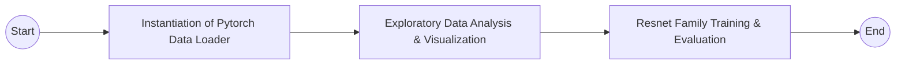

## Food Quality Assessment using Deep Learning

### Dataset 
The dataset used was Kaggle Fresh & Rotten Classification dataset.
The Fresh and Rotten/Stale Fruits and Vegetables Classification Dataset is a comprehensive collection of high-quality images specifically curated for the purpose of training and evaluating classification models. 
This dataset is designed to aid in the development of computer vision algorithms that can accurately distinguish between fresh and rotten/stale produce.

### Models Used
The following models from the Resnet Family of Convolutional Neural Networks were used for this project.
 - Resnet 18
 - Resnet 34
 - Resnet 50
 - Resnet 101
 - Resent 152

### Results
| Model      | Training Accuracy | Validation Accuracy |
|------------|-------------------|---------------------|
| Resnet 18  | 97.736            | 96.955              |
| Resnet 34  | 99.742            | 99.564              |
| Resnet 50  | 99.155            | 99.440              |
| Resnet 101 | 97.606            | 96.816              |
| Resnet 152 | 97.548            | 97.117              |
